# Agentic QA

A free site that teaches QA engineers and SDETs how to use Claude Code for software testing. It also has modules on Linux, manual testing, system design, performance testing with k6, AI engineering and agents, testing AI and ML systems, and DevOps and the cloud, in plain words for testers.

**Read it:** https://kawsar-95.github.io/ai-testing-guide/

[](https://github.com/kawsar-95/ai-testing-guide/actions/workflows/deploy-pages.yml)
[](LICENSE)

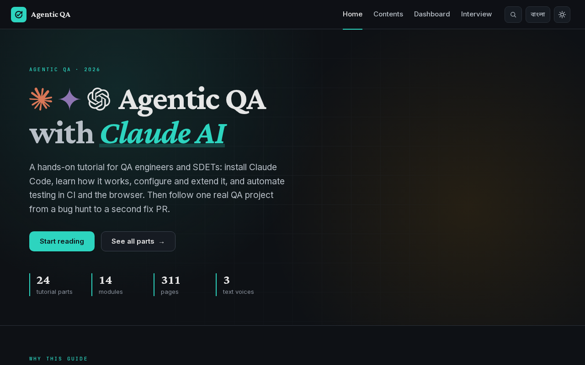

## Contents

- [What you learn](#what-you-learn)
- [Features](#features)
- [How the content is made](#how-the-content-is-made)
- [Run it locally](#run-it-locally)
- [Scripts and checks](#scripts-and-checks)
- [Project structure](#project-structure)
- [Add or change a page](#add-or-change-a-page)
- [Deploy](#deploy)
- [Tech stack](#tech-stack)
- [Documentation](#documentation)
- [License](#license)

## What you learn

The site has 311 pages. 293 of them are lessons in 15 sections: the tutorial and 14 modules. The other 18 are the home page, the 14 module home pages, and 3 helper pages.

| Section | Pages | What it teaches |
|---|---|---|
| [Tutorial](https://kawsar-95.github.io/ai-testing-guide/getting-started/setup/) | 24 | Claude Code for software testing (the 6 groups below) |
| [Linux](https://kawsar-95.github.io/ai-testing-guide/linux/) | 12 stages, 103 topics | A command sheet for each stage: one card per topic, one row per command, a tick on each card |
| [Fundamentals](https://kawsar-95.github.io/ai-testing-guide/fundamentals/) | 11 chapters, 117 topics | Manual testing. In chapters 1–10, each topic has the author's notes and an ISTQB version, with a switch. Chapter 11 is 50 interview questions. |
| [System Design](https://kawsar-95.github.io/ai-testing-guide/system-design/) | 15 case studies | How well-known systems work (Kafka, YouTube, WhatsApp, and more) |
| [Architecture](https://kawsar-95.github.io/ai-testing-guide/architecture/) | 19 topics and 30 practice questions | The building blocks of system architecture |
| [Course](https://kawsar-95.github.io/ai-testing-guide/course/) | 40 topics (55 entries with links) | System design from the ground up, in 6 parts |
| [k6](https://kawsar-95.github.io/ai-testing-guide/k6/) | 20 topics in 5 parts | Performance testing and the k6 tool, from the first script to CI |
| [AI Engineering](https://kawsar-95.github.io/ai-testing-guide/ai-engineering/) | 28 topics in 2 parts | What AI engineering involves, from prompts and RAG to evals, guardrails, observability, and system design |
| [AI Harnesses](https://kawsar-95.github.io/ai-testing-guide/harness/) | 6 topics | How an AI harness works: the agent loop, tool calling, context, checkpoints, permissions, and guardrails |
| [AI Skills](https://kawsar-95.github.io/ai-testing-guide/ai-skills/) | 20 skills in 4 tiers | 20 AI skills, from prompting to fine-tuning, and how a tester uses each one |
| [AI Concepts](https://kawsar-95.github.io/ai-testing-guide/ai-concepts/) | 9 topics | Agent loops, MCP, subagents, AI gateways, cost, evals, guardrails, observability, and the agent harness |
| [Agent Memory](https://kawsar-95.github.io/ai-testing-guide/agent-memory/) | 7 topics | The 7 types of memory of an AI agent: working, semantic, episodic, procedural, retrieval, parametric, and prospective |
| [AI Agents](https://kawsar-95.github.io/ai-testing-guide/ai-agents/) | 10 topics | How an AI agent works, step by step: the trigger, the context, the model's decision, the tools, the stop check, memory, guardrails, observability, and the final output |
| [AI/ML Testing](https://kawsar-95.github.io/ai-testing-guide/ai-ml-testing/) | 47 topics in 2 phases | Testing AI and ML systems: LLM behavior, prompt testing, automated evals, hallucination detection, RAG and agent testing, red teaming, observability, and CI/CD eval gates |
| [DevOps & Cloud](https://kawsar-95.github.io/ai-testing-guide/devops/) | 24 topics in 7 parts | Git, CI/CD, Docker, Kubernetes, AWS, Terraform, Ansible, monitoring, and CNCF projects: a short sourced explanation of each, then KodeKloud Shorts |

Three helper pages sit beside the sections: [Contents](https://kawsar-95.github.io/ai-testing-guide/contents/) lists everything, [Dashboard](https://kawsar-95.github.io/ai-testing-guide/dashboard/) shows your progress, and [Interview](https://kawsar-95.github.io/ai-testing-guide/interview/) links to the interview material.

### The Claude Code tutorial

The tutorial has 24 parts in 6 groups. Each part is one page.

| Group | Parts |
|---|---|
| **Getting Started** | 01 [Install Claude Code](https://kawsar-95.github.io/ai-testing-guide/getting-started/setup/) · 02 [Claude Models](https://kawsar-95.github.io/ai-testing-guide/getting-started/models/) · 03 [Permission Modes](https://kawsar-95.github.io/ai-testing-guide/getting-started/permission-modes/) |
| **Foundations** | 04 [How Claude Code Works](https://kawsar-95.github.io/ai-testing-guide/foundations/how-claude-code-works/) · 05 [Prompting for QA](https://kawsar-95.github.io/ai-testing-guide/foundations/prompting/) · 06 [Test Design with Claude](https://kawsar-95.github.io/ai-testing-guide/foundations/test-design/) · 07 [Key Principles](https://kawsar-95.github.io/ai-testing-guide/foundations/principles/) |
| **Configure** | 08 [CLAUDE.md & Memory](https://kawsar-95.github.io/ai-testing-guide/configure/claude-md/) · 09 [Settings & the .claude Folder](https://kawsar-95.github.io/ai-testing-guide/configure/settings/) |
| **Extend** | 10 [Skills & Commands](https://kawsar-95.github.io/ai-testing-guide/extend/skills/) · 11 [Subagents](https://kawsar-95.github.io/ai-testing-guide/extend/subagents/) · 12 [Hooks](https://kawsar-95.github.io/ai-testing-guide/extend/hooks/) · 13 [MCP Servers](https://kawsar-95.github.io/ai-testing-guide/extend/mcp/) · 14 [Plugins & Marketplaces](https://kawsar-95.github.io/ai-testing-guide/extend/plugins/) |
| **Automate** | 15 [Headless & CI](https://kawsar-95.github.io/ai-testing-guide/automate/headless/) · 16 [GitHub Actions](https://kawsar-95.github.io/ai-testing-guide/automate/github-actions/) · 17 [Browser Testing with Playwright](https://kawsar-95.github.io/ai-testing-guide/automate/playwright/) |
| **Case Study** | 18 [The Practice Project](https://kawsar-95.github.io/ai-testing-guide/case-study/overview/) · 19 [The dMoney Codebase](https://kawsar-95.github.io/ai-testing-guide/case-study/codebase-tour/) · 20 [Bug Hunting with a Review Gate](https://kawsar-95.github.io/ai-testing-guide/case-study/bug-hunt/) · 21 [From Issue to Reviewed PR](https://kawsar-95.github.io/ai-testing-guide/case-study/pr-review/) · 22 [Design, Execute, Fix, Retest](https://kawsar-95.github.io/ai-testing-guide/case-study/test-and-retest/) · 23 [Load and Browser Automation](https://kawsar-95.github.io/ai-testing-guide/case-study/automation/) · 24 [What to Fix in the Setup](https://kawsar-95.github.io/ai-testing-guide/case-study/lessons/) |

New to Claude Code? Start with parts 01, 03, and 04. To see the features work together in one real QA project, read parts 18–24.

## Features

### Navigation and the Contents page

The top navigation has four plain links: **Home**, **Contents**, **Dashboard**, and **Interview**. The current link has a teal underline. A tutorial page or a module page has no current link. You reach a module from the home page or the Contents page. Next to the links are the search button, the voice button, the install button (in Chromium browsers), and the theme button.

The home page has a hero with a stats row (tutorial parts, modules, pages, and text voices), a "Why this guide" block, and the course structure as two ruled lists: the tutorial groups (read in order) and the modules (open any).

The [Contents](https://kawsar-95.github.io/ai-testing-guide/contents/) page shows every tutorial group and every module as one row. Open a row to see its pages. The 11 modules with a checklist show your progress as a percent on their row. System Design, AI Harnesses, and DevOps & Cloud have no checklist.

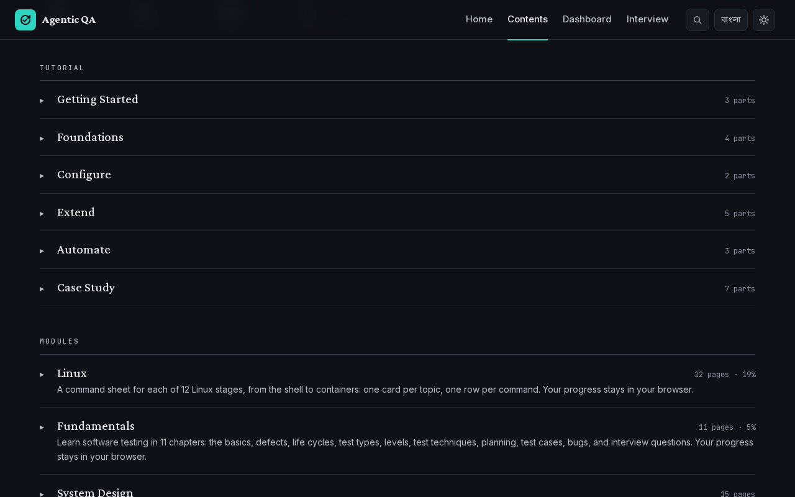

The left list shows the pages of the module you are in, one line for each, under the name of the module (a link to its home page) and an **All modules** link to Contents. The drawer shows the same pages under the four links of the top navigation.

### Interview preparation

The [Interview](https://kawsar-95.github.io/ai-testing-guide/interview/) page has three cards. Each card links to material that is already on the site:

| Card | Goes to |
|---|---|
| Testing interview questions | Fundamentals chapter 11: 50 manual testing questions with answers |
| System design practice | The Architecture practice page: 30 questions, each with a model answer |
| How to answer a design interview | The Course page about the steps of a design interview |

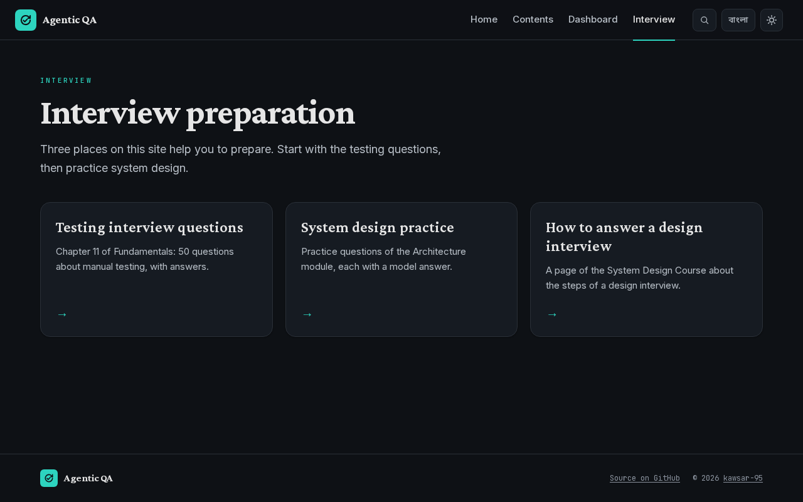

### Three voices for every section

All 281 MDX pages (every content page except the 12 Linux command sheets) let you read each `##` section in three voices:

| Voice | What it is |
|---|---|
| **Technical** | The full text, with the citations, the code, and the callouts |
| **সহজ English** | The same facts in plain English |
| **বাংলা** | The same facts in Bangla. Commands, flags, paths, product names, and acronyms stay in English. |

A switcher with three buttons sits under each section heading: `Technical`, `সহজ English`, and `বাংলা`. The Left, Right, Home, and End keys move the selection. A click changes one section only. A Linux stage page is a command sheet with no switcher: the `বাংলা` button in the header switches its English and Bangla glosses. The `Key words` tables have one voice only.

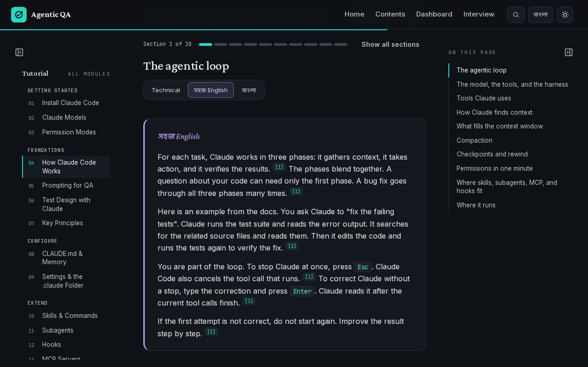

The `বাংলা` button in the header sets the default voice for the whole site. Click it and every section switches to Bangla, and the button changes to `English`. The site saves the choice in your browser and sets it before the first paint, so the page does not flash. In Bangla mode, the Bangla text moves to the first position of each switcher.

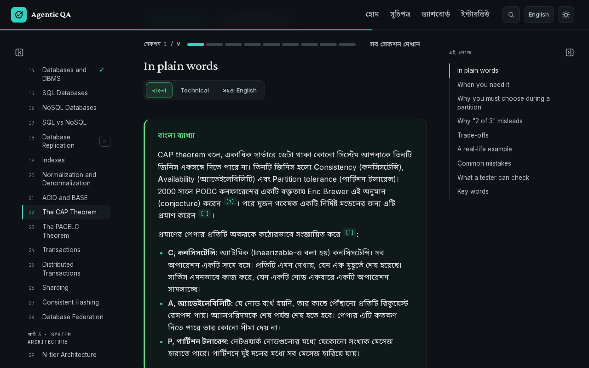

The same button also translates the interface. In Bangla mode, the header links, the hero, the buttons, the progress labels, the left lists, the search dialog, the footer, and the 404 page show Bangla text. The titles and descriptions of pages, stages, chapters, and topics, and the names of the modules, stay in English. Each English text has a Bangla twin in `lib/bn/`, and a test checks that no key is missing.

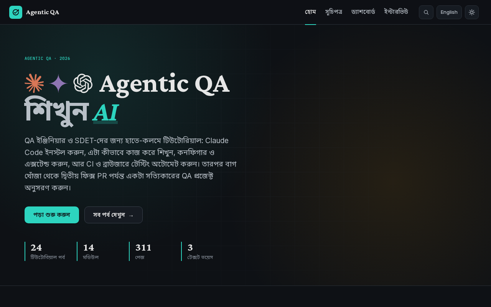

The Bangla text of the Course follows the term style of [systemdesignbangla.com](https://www.systemdesignbangla.com/): common concept words are in Bangla letters, and acronyms, products, and commands stay in English. The plain English and Bangla texts add no fact that the Technical text does not have. A separate agent checked this for each page.

A link or a search result that points into a hidden voice opens that voice and scrolls to the target.

### Fundamentals: two versions of each topic

The 11 Fundamentals chapters teach manual testing. Chapters 1–10 have two versions of every topic: **My notes** (the author's notes, with images) and **ISTQB** (the ISTQB syllabus and glossary, with citations and diagrams). A switch above the chapter changes the version. The site remembers your choice. If the notes and ISTQB disagree, the notes version has a warning that points you to the ISTQB definition. Each version also has the plain English and Bangla voices. Chapter 11 is 50 interview questions.

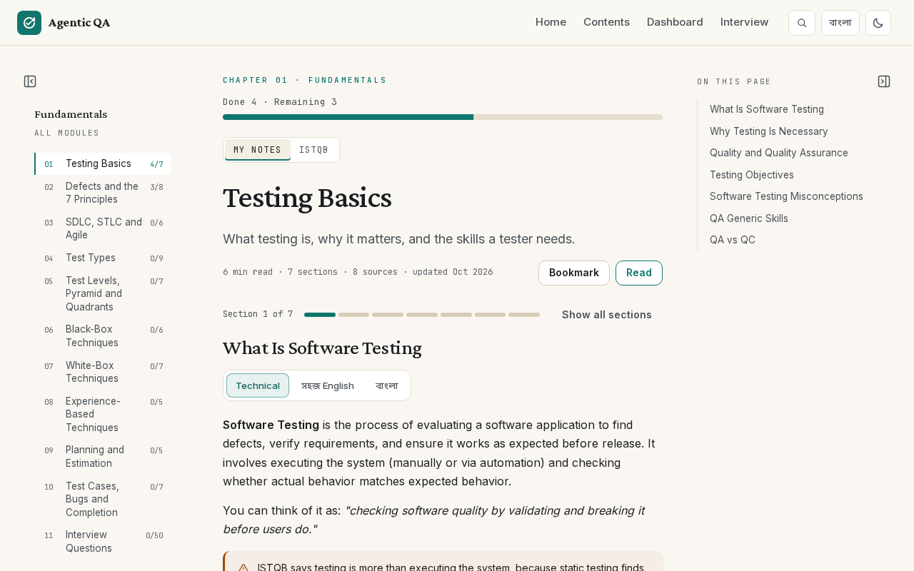

The ISTQB version has seven inline diagrams, for example the test pyramid, the test quadrants, and the bug life cycle. Each diagram has a text description under it.

### Progress, bookmarks, and the Dashboard

The site tracks your work in your browser. It never sends it to a server.

- **Topic checklists:** 11 modules show your progress with a bar: Linux, Fundamentals, Architecture, Course, k6, AI Engineering, AI Skills, AI Concepts, Agent Memory, AI Agents, and AI/ML Testing. Linux and Fundamentals have a checkbox for each topic. The other nine have a mark-as-done button at the end of each page, and Architecture also has a checkbox for each of its 30 practice questions. System Design, AI Harnesses, and DevOps & Cloud have no checklist.
- **Pages read and bookmarks:** each content page has a **Mark as read** toggle and a **Bookmark** toggle in its meta row.
- **Last page:** the site remembers the last content page that you opened.

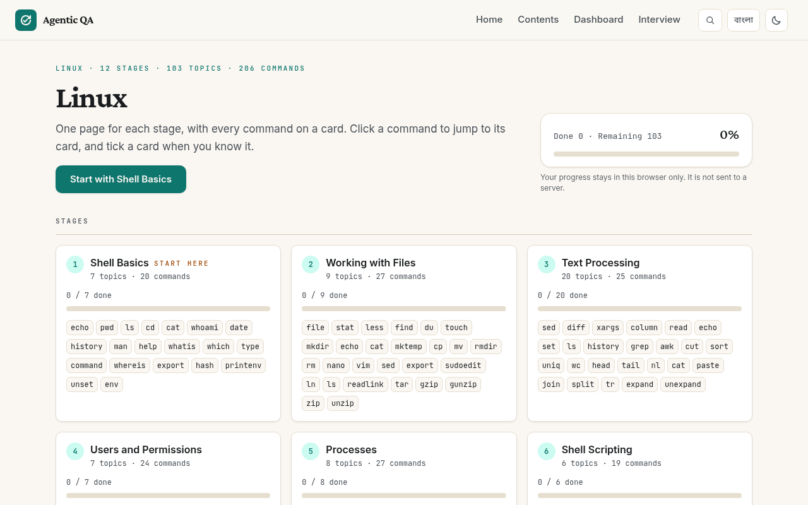
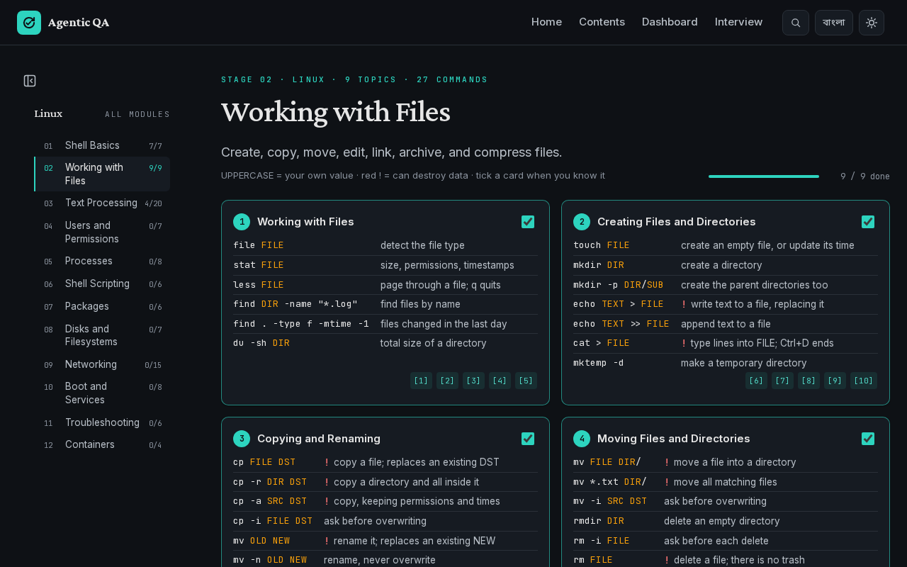

The [Dashboard](https://kawsar-95.github.io/ai-testing-guide/dashboard/) shows the pages you read (`N / 293`) with a progress bar, beside a Continue reading block. Below them, one row for each of the 11 modules with a checklist shows its name, a bar, and `done / total`. Then come your bookmarks and the pages you read in each module. **Export** downloads your progress as `progress-YYYY-MM-DD.json`. **Reset** asks for confirmation, then clears all progress.

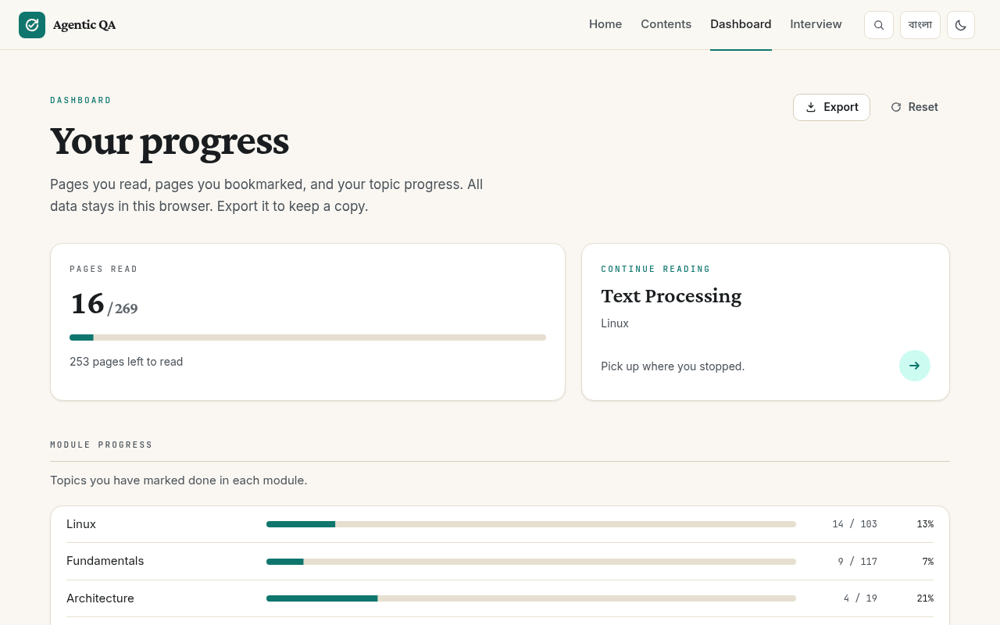

The Dashboard ends with an "About the author" block: a photo, the role, a short bio, and links to the portfolio, LinkedIn, GitHub, X, and the resume.

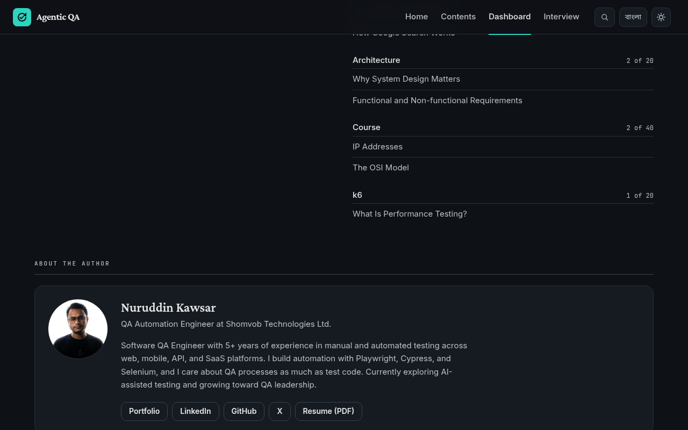

### Search

Press <kbd>Ctrl</kbd>/<kbd>Cmd</kbd>+<kbd>K</kbd>, or click the search button, to search all pages and all sections of every module. The search runs in your browser, so it also works offline. It finds prefixes and small typing mistakes, and it ranks titles first. The Up and Down keys move through the results, Enter opens one, and Escape closes the dialog. The plain English and Bangla texts are searchable too.

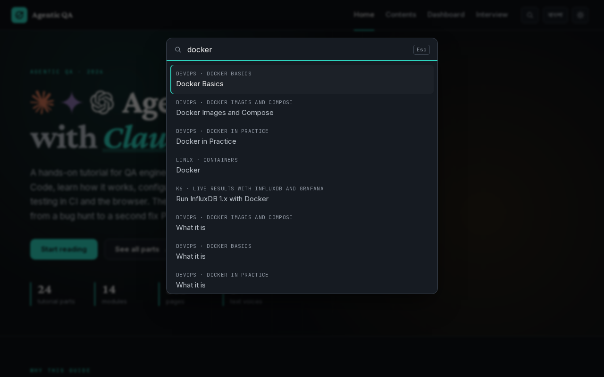

### Learning from real systems

- **System Design:** 15 case studies explain how one well-known system works. Each case has the same shape: the problem in plain words, a text diagram of the big picture, the mechanisms, a table of key words, and what a tester can learn.
- **Architecture:** 19 topics, each with a diagram, and a practice page with 30 questions. Each question has a checkbox and a model answer that you open when you are ready.
- **Course:** 40 topics from IP addresses to case studies, in 6 parts. Each topic has a real-life example, common mistakes, and what a tester can check. The Course list has 15 more entries: links to the Architecture or System Design page that already covers the topic.
- **Reels:** the topic pages of Architecture, System Design, AI Engineering, AI Harnesses, AI Skills, AI Concepts, Agent Memory, How AI Agents Work, and AI/ML Testing, the stages of Linux, the chapters of Fundamentals, 18 topics of the Course, and the 24 topics of DevOps & Cloud end with short videos (YouTube Shorts) by other creators, in English and Bangla: 2 to 4 for each topic, up to 16 on a DevOps & Cloud page (a shelf of KodeKloud Shorts), and fewer for the few topics where no clip passed the review. A page with 6 or more reels shows 4, and a "Show N more reels" button opens the rest. They are other people's work and are not part of the fact-checked text. A reel shows its title first, and nothing loads from YouTube until you press **Play**. A reel needs a connection to play, so it does not play offline.

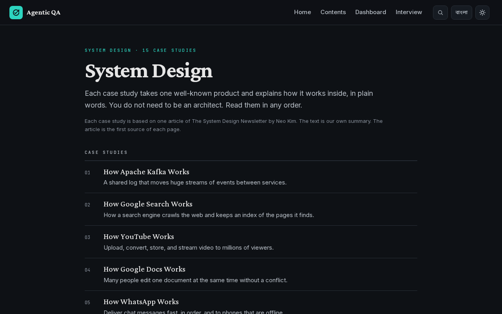

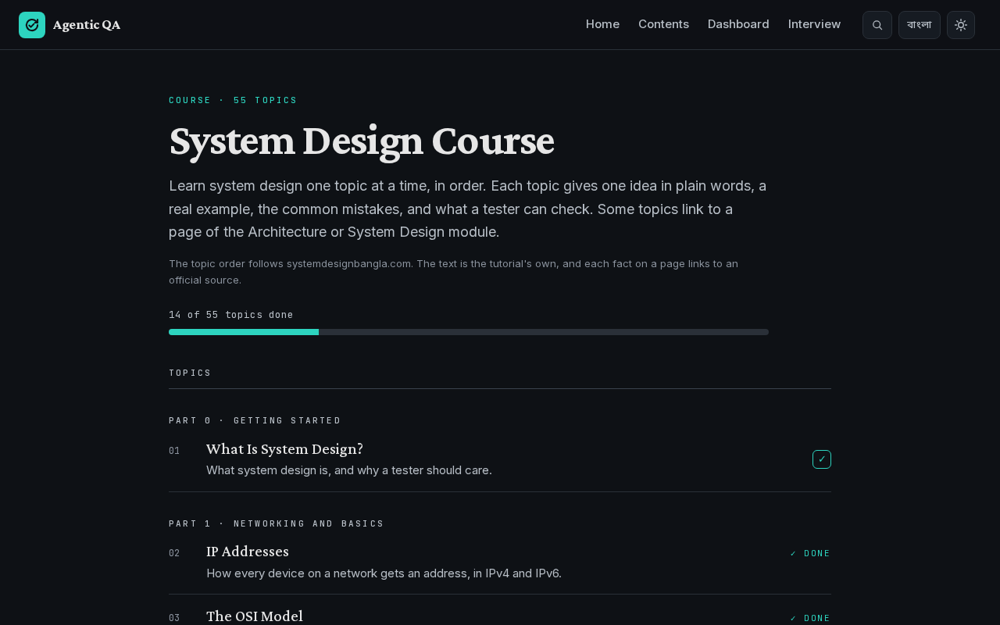

### Reading aids

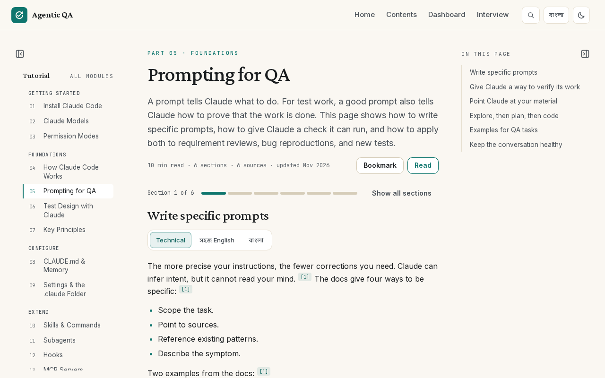

- **Three columns:** a left list of the pages of the current module, the text, and an "On this page" list of the sections. The current section stays marked as you scroll. The left list shows from 820 px wide, and "On this page" from 1280 px.
- **Close a side column:** a button at the top of each side column closes it to a thin rail, and the same button opens it again. The text keeps its width. The site remembers each choice and applies it before the first paint, so the page does not jump.
- **One section at a time:** a page with 3 or more `##` sections shows one section and hides the others. A step bar sits above the section, and Previous and Next buttons sit below it. **Show all sections** turns this off, and the site remembers your choice. A link into a hidden section shows that section. Without JavaScript, every section shows.
- **Reading time and progress:** each page shows `N min read`. An MDX page counts its words at 200 a minute and the lines of its code blocks at 20 a minute, and a bar under the header shows how far you read. A back-to-top button shows after one screen of scrolling.
- **Meta row:** the reading time, the number of sections and sources, the update date, and the Bookmark and Mark as read toggles. A "Suggest an edit" link beside the Sources opens the page source on GitHub.
- **Previous and next:** a tutorial page ends with cards to the previous and the next part. A module page ends with a row of links: the previous page, the module home, and the next page.
- **Citations:** each fact has a `[n]` link to the numbered Sources list at the end of the page.
- **Code blocks:** syntax colors (Shiki), a language label, and a Copy button. Code blocks stay dark in both themes.
- **Callouts and cards:** note, tip, warning, and danger boxes, and Do and Don't cards.
- **Tables and images:** tables scroll sideways in their own box, and below 640 px each row becomes a card. Each image has a link to open it in full size.

### Light and dark themes

The site follows the theme of your system and remembers your choice. The theme button in the header switches it. The theme loads before the first paint, so the page does not flash the wrong theme. Every text color has a contrast ratio of 4.5:1 or more in both themes, and a test checks it.

### Phones and small screens

The layout adapts to phone widths. Below 1200 px the top navigation moves into the drawer: the drawer shows the four links (Home, Contents, Dashboard, Interview) above the pages of the current module. Below 820 px, where the left list hides, a **Contents** button above the title of a content page also opens the drawer. The drawer traps the focus, closes with Escape, and gives the focus back to the button that opened it. On phones, tables and code scroll inside their own box.

| A content page | The drawer |
|---|---|
| 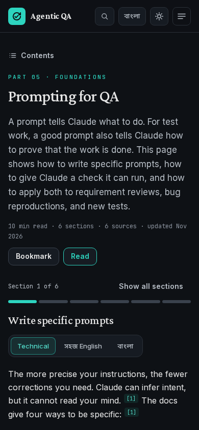 | 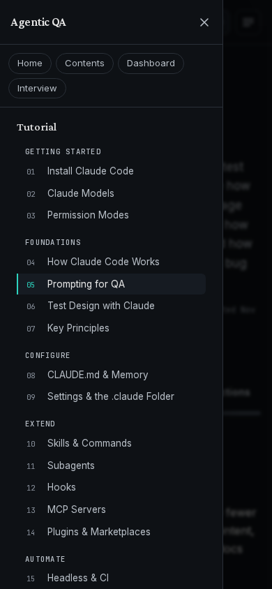 |

### Install it and read offline

The site is a progressive web app (PWA). Chromium browsers show an install button (a download icon) in the header. After the first visit, the service worker has all 311 pages, the search index, and the images of the pages in its cache. Pages open from the cache first and update in the background. A page that is not in the cache shows the 404 page. Each new build replaces the old cache.

### Accessibility

The site has a skip link, visible focus rings, and `aria-pressed` on each on/off button: Bookmark, Mark as read, mark as done, the voice switcher, and the version switch. The theme, voice, and sidebar buttons are named for what a click does, and the name of a button with a visible word starts with that word. Motion is off if your system asks for reduced motion. The switchers, the drawer, and the search dialog work with the keyboard only.

### Privacy

The site has no accounts and no server. Your progress, your bookmarks, and your choices (theme, voice, version, closed side columns, and one section at a time) stay in the `localStorage` of your browser. Google Analytics is off unless the owner sets `NEXT_PUBLIC_GA_ID` at build time. A reel contacts YouTube (`youtube-nocookie.com`) only after you press Play on it.

## How the content is made

Every page states facts that a reader can check.

- **Sources:** facts come from official docs first (`code.claude.com/docs`, `platform.claude.com/docs`, `modelcontextprotocol.io`, `playwright.dev`, and the GitHub repos of the tools), then from primary sources such as the ISTQB syllabi, IETF RFCs, the Google SRE books, OWASP and NIST documents, and the original papers on arXiv. Blogs, forums, and AI summaries are not used. One module has a documented exception: source 1 of each System Design page is its article of The System Design Newsletter, a blog, and the page can also cite the primary sources that the article links to. [CLAUDE.md](CLAUDE.md) has the rules of each module.
- **Citations:** each fact has a numbered `[n]` link to the Sources list at the end of its page.
- **Fact-check:** an agent that did not write the page checked each claim against its cited source. Each page has a report in [`docs/superpowers/research/`](docs/superpowers/research/). A page is done only when its report ends with `Open FAILs: 0`.
- **Voices:** each page has a second report. An agent that did not write the voices checked them against the Technical text. `npm test` checks that each `সহজ English` panel is in English and each `বাংলা` panel is in Bangla.
- **Readability:** a cognitive-load audit ranked every `##` section by its length, its density of terms, and the length of its sentences. The densest sections were split in two with no text rewritten, or their Technical text was edited for form only; fresh agents checked that the edits changed no claim. [docs/superpowers/research/cognitive-load-audit.md](docs/superpowers/research/cognitive-load-audit.md) has the method, the numbers, and what is left.
- **Case study:** parts 18 and 20–24 describe the author's private practice workspace. Part 19 tours its public version, kawsar-95/genAI-project. Facts about that workspace have no citation link. A separate agent checked each one against the workspace files. Emails, phone numbers, and similar values are replaced with placeholders.
- **Dates:** each page shows the date of its last update. "Suggest an edit" opens the page source on GitHub.

Claude Code changes often. If a page is out of date, open an issue or a pull request.

## Run it locally

You need Node.js 22.18 or newer. The check scripts also need Python 3.

```bash
git clone https://github.com/kawsar-95/ai-testing-guide.git
cd ai-testing-guide
npm install
npm run dev
```

Open http://localhost:3000.

To build and preview the static site:

```bash
npm run build                          # writes the static site to out/
python3 -m http.server 8000 -d out     # serves it at http://localhost:8000
```

`next start` does not work with a static export. Use the preview command above.

## Scripts and checks

| Command | What it does |
|---|---|
| `npm run dev` | Starts the dev server. The offline app (service worker) works only in a production build. |
| `npm run build` | Builds the static site into `out/`. |
| `npm test` | Runs the unit tests in `tests/` with `node --test`. |
| `python3 -m unittest scripts/test_checks.py` | Runs the unit tests of the Python check scripts. |
| `python3 -m unittest scripts/test_linux_scripts.py` | Runs the unit tests of the Linux research scripts. |
| `python3 scripts/linux_fetch.py <links.md> <out-dir>` | Fetches the pages of a link list as plain text, for research. It needs a network. Never commit that text: it is third-party text. |
| `python3 scripts/linux_overlap.py <file.mdx> <raw-dir>` | Finds runs of words that a page copies from the fetched text. |
| `node scripts/verify_linux_sheets.mjs` | Checks the commands and flags of the Linux sheets against the pages they cite. It needs a network. |
| `python3 -m unittest scripts/test_ai_ml_course_fetch.py` | Runs the unit tests of the script that scrapes the AI/ML Testing course syllabus. |
| `python3 scripts/ai_ml_course_fetch.py <out-dir>` | Scrapes the syllabus of the AI & ML Testing course (Phase 1 and Phase 2) from journeytoautomation.org. It needs a network. Its output is third-party text, so keep it out of `content/`. |
| `python3 -m unittest scripts/test_ai_ml_testing_pages_gen.py` | Runs the unit tests of the AI/ML Testing page generator. |
| `python3 scripts/ai_ml_testing_check_sources.py` | Checks that each source URL of the AI/ML Testing module resolves. It needs a network. |
| `python3 -m unittest scripts/test_devops_claimcheck.py` | Runs the unit tests of the DevOps & Cloud quote checker. |
| `python3 scripts/devops_claimcheck.py` | Looks each quote of the DevOps & Cloud research notes up in the text of the source page that it cites. It needs a network. |
| `node scripts/check-reels.ts` | Asks YouTube about every reel on the pages of the 13 modules that have reels: still public and embeddable, same title and channel, still a Short. It needs a network, so it is not part of `npm test`. Exit code 2 means that the check could not be done. |
| `python3 scripts/check_routes.py out` | Checks that every route of the route maps has a built page. |
| `python3 scripts/check_links.py out` | Checks internal links and assets. |
| `python3 scripts/check_outline.py out` | Checks that every "On this page" link has a target. |
| `python3 scripts/check_sources.py out` | Checks the meta line, the citations, and the Sources list of each content page. It must print `OK 293 pages checked, 0 skipped`. |

Run the `out` checks after `npm run build`, on a build without a base path.

## Project structure

```text
app/                 Routes, root layout, global styles, sitemap, robots, search index, PWA files
components/          Site shell, navigation, page parts, MDX components, voices, progress, module pages
content/<group>/     The 281 MDX pages: 24 tutorial, 11 Fundamentals, 15 System Design, 20 Architecture, 40 Course, 20 k6, 28 AI Engineering, 6 AI Harnesses, 20 AI Skills, 9 AI Concepts, 7 Agent Memory, 10 AI Agents, 47 AI/ML Testing, 24 DevOps & Cloud
lib/                 nav.ts (tutorial page order), one data file for each module, the Linux command sheets (linux/sheets/), the reels (reels/), search, voices, the Bangla twins of the UI text (bn/), PWA, and other helpers
tests/               Unit tests (node --test)
scripts/             Check scripts (Python and Node), the route maps (one JSON file for the tutorial, each module, and each helper page), the AI/ML Testing page generator, and research tools
public/              Icons, images of the pages, and static files
docs/                Architecture, screenshots (docs/assets), design specs, plans, the content audit, research notes
DESIGN.md            The design tokens: colors, type scale, spacing, radii, and components
.github/workflows/   The GitHub Pages deploy workflow
```

For how the parts fit together, read [docs/ARCHITECTURE.md](docs/ARCHITECTURE.md).

## Add or change a page

For a tutorial page:

1. Create or edit `content/<group>/<slug>.mdx`. Use the page template in [CLAUDE.md](CLAUDE.md#page-template).
2. For a new page, add it to `lib/nav.ts` and to `scripts/route-map.json`.
3. Give each fact a `<Cite n={k} />` and a matching entry in `page.sources`.
4. Run `npm test`, `npm run build`, and the checks above.

The other modules keep their page lists in their own data files: `lib/linux/stages.ts`, `lib/fundamentals/chapters.ts`, `lib/system-design/cases.ts`, `lib/architecture/topics.ts`, `lib/course/topics.ts`, `lib/k6/topics.ts`, `lib/ai-engineering/topics.ts`, `lib/harness/topics.ts`, `lib/ai-skills/topics.ts`, `lib/ai-concepts/topics.ts`, `lib/agent-memory/topics.ts`, `lib/ai-agents/topics.ts`, `lib/ai-ml-testing/topics.ts`, and `lib/devops/topics.ts`. Each module has its own route map in `scripts/`. A page with voices also needs a voice fact-check report. In a module with reels, a new page also needs its entry in `lib/reels/<module>.ts`, except in the Course, where only a topic with a clip has one. `npm test` checks that the lists, the MDX files, the route maps, and the reels files agree. To add a whole module, follow [Flat modules](CLAUDE.md#flat-modules) in CLAUDE.md.

The AI/ML Testing pages are generated, so do not edit `content/ai-ml-testing/*.mdx` by hand. To add or change a page, edit its data in `scripts/ai_ml_testing_pages_p*.py` (the sources are in `scripts/ai_ml_testing_sources.py`) and the list in `lib/ai-ml-testing/topics.ts`. Then run `python3 scripts/ai_ml_testing_pages_gen.py` to write the MDX pages, and `python3 scripts/ai_ml_testing_gen.py` to write `scripts/ai-ml-testing-route-map.json` and `tests/ai-ml-testing.test.ts` from the list. A page that changes after the module date gets its own `updated` date in its data; without one, it shows the module date (`UPDATED` in `scripts/ai_ml_testing_pages_gen.py`).

For a change to the look, read [DESIGN.md](DESIGN.md) first: its tokens are the rules for colors, type, spacing, and radii, and both themes must stay in step. `npm test` checks that the color tokens of DESIGN.md and `app/globals.css` match in both themes, and `npx -y @google/design.md lint DESIGN.md` must report 0 errors. `npx skills experimental_install` restores the design skills that `skills-lock.json` lists, and `.mcp.json` sets up the Playwright MCP server for browser checks. The rules are in [CLAUDE.md](CLAUDE.md#frontend-design-engineering-rules).

[CLAUDE.md](CLAUDE.md) has the full rules: the MDX components, the voices, the citation rules, and the research and fact-check workflow. It is written as the guide for AI coding agents, and it is the most complete reference for humans too.

## Deploy

Each push to `main` deploys the site to GitHub Pages through [`.github/workflows/deploy-pages.yml`](.github/workflows/deploy-pages.yml). The workflow runs `npm ci`, `npm test`, and `npm run build` on Node 24, then publishes `out/`. You can also start it by hand from the Actions tab. It does not run on pull requests, so run the checks yourself before you open one.

The site lives under `/ai-testing-guide/`. The workflow sets `PAGES_BASE_PATH` for that path and `NEXT_PUBLIC_SITE_URL` for canonical URLs and the sitemap. Local builds serve from `/`. See [docs/ARCHITECTURE.md](docs/ARCHITECTURE.md#base-path-github-pages) for the rules that keep links correct under the base path.

`NEXT_PUBLIC_GA_ID` is optional. If you set it, the build adds Google Analytics.

## Tech stack

| Part | Choice |
|---|---|
| Framework | Next.js 16 (App Router, static export), React 19, TypeScript |
| Content | MDX with `@next/mdx`, `remark-gfm`, `rehype-slug`, and Shiki (`@shikijs/rehype`) |
| Styles | Tailwind CSS 4 and CSS design tokens |
| Fonts | Crimson Pro, Inter, JetBrains Mono, and Noto Sans Bengali (`next/font/google`) |
| Search | MiniSearch, with a static search index |
| Offline | A service worker and a web manifest, built from `lib/pwa.ts` |
| Tests | `node --test` for the TypeScript tests (Node runs them without a compile step from 22.18) and Python `unittest` for the scripts |
| Hosting | GitHub Pages, deployed by GitHub Actions |

## Documentation

| Document | What it has |
|---|---|
| [CLAUDE.md](CLAUDE.md) | The rules for each module, the voices, the MDX components, and the content workflow. The most complete reference. |
| [docs/ARCHITECTURE.md](docs/ARCHITECTURE.md) | How the site is built: routes, ordered lists, MDX pipeline, voices, progress, search, theme, PWA, base path, deploy, and checks |
| [DESIGN.md](DESIGN.md) | The design tokens: colors, type scale, spacing, radii, and component variants, with the reason for each. Read it before you change the UI. |
| [docs/superpowers/specs/](docs/superpowers/specs/) and [docs/superpowers/plans/](docs/superpowers/plans/) | The design and the plan of each phase and module |
| [docs/superpowers/research/](docs/superpowers/research/) | The research notes and the fact-check reports of each page, and the cognitive-load audit of the text |
| [docs/superpowers/audits/](docs/superpowers/audits/) | The audit of the outdated claims of the first tutorial text |
| [docs/assets/](docs/assets/) | The screenshots of this README |

## License

[MIT](LICENSE)
