# Software Testing with AI

A free site that teaches QA engineers and SDETs how to use Claude Code for software testing. It also has notes on Linux, manual testing, and system design, in plain words for testers.

**Read it:** https://kawsar-95.github.io/ai-testing-guide/

[](https://github.com/kawsar-95/ai-testing-guide/actions/workflows/deploy-pages.yml)
[](LICENSE)

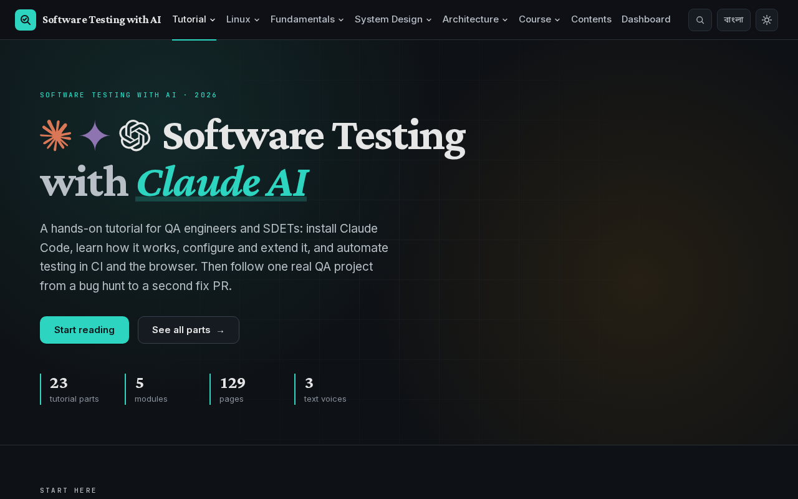

## Contents

- [What you learn](#what-you-learn)
- [Features](#features)
- [How the content is made](#how-the-content-is-made)
- [Run it locally](#run-it-locally)
- [Scripts and checks](#scripts-and-checks)
- [Project structure](#project-structure)
- [Add or change a page](#add-or-change-a-page)
- [Deploy](#deploy)
- [Tech stack](#tech-stack)
- [Documentation](#documentation)
- [Credits](#credits) and [License](#license)

## What you learn

The site has 129 pages in 6 sections:

| Section | Pages | What it teaches |
|---|---|---|
| [Tutorial](https://kawsar-95.github.io/ai-testing-guide/getting-started/setup/) | 23 | Claude Code for software testing (the 6 groups below) |
| [Linux](https://kawsar-95.github.io/ai-testing-guide/linux/) | 12 stages, 103 topics | A Linux roadmap with a progress checklist |
| [Fundamentals](https://kawsar-95.github.io/ai-testing-guide/fundamentals/) | 11 chapters, 117 topics | Manual testing. Each topic has the author's notes and an ISTQB version, with a switch. |
| [System Design](https://kawsar-95.github.io/ai-testing-guide/system-design/) | 15 case studies | How well-known systems work (Kafka, YouTube, WhatsApp, and more) |
| [Architecture](https://kawsar-95.github.io/ai-testing-guide/architecture/) | 19 topics and 30 practice questions | The building blocks of system architecture |
| [Course](https://kawsar-95.github.io/ai-testing-guide/course/) | 40 topics (55 entries with links) | System design from the ground up, in 6 parts |

Two more pages help you find and track your work: [Contents](https://kawsar-95.github.io/ai-testing-guide/contents/) lists everything, and [Dashboard](https://kawsar-95.github.io/ai-testing-guide/dashboard/) shows your progress.

### The Claude Code tutorial

The tutorial has 23 parts in 6 groups. Each part is one page.

| Group | Parts |
|---|---|
| **Getting Started** | 01 [Install Claude Code](https://kawsar-95.github.io/ai-testing-guide/getting-started/setup/) · 02 [Claude Models](https://kawsar-95.github.io/ai-testing-guide/getting-started/models/) · 03 [Permission Modes](https://kawsar-95.github.io/ai-testing-guide/getting-started/permission-modes/) |
| **Foundations** | 04 [How Claude Code Works](https://kawsar-95.github.io/ai-testing-guide/foundations/how-claude-code-works/) · 05 [Prompting for QA](https://kawsar-95.github.io/ai-testing-guide/foundations/prompting/) · 06 [Test Design with Claude](https://kawsar-95.github.io/ai-testing-guide/foundations/test-design/) · 07 [Key Principles](https://kawsar-95.github.io/ai-testing-guide/foundations/principles/) |
| **Configure** | 08 [CLAUDE.md & Memory](https://kawsar-95.github.io/ai-testing-guide/configure/claude-md/) · 09 [Settings & the .claude Folder](https://kawsar-95.github.io/ai-testing-guide/configure/settings/) |
| **Extend** | 10 [Skills & Commands](https://kawsar-95.github.io/ai-testing-guide/extend/skills/) · 11 [Subagents](https://kawsar-95.github.io/ai-testing-guide/extend/subagents/) · 12 [Hooks](https://kawsar-95.github.io/ai-testing-guide/extend/hooks/) · 13 [MCP Servers](https://kawsar-95.github.io/ai-testing-guide/extend/mcp/) · 14 [Plugins & Marketplaces](https://kawsar-95.github.io/ai-testing-guide/extend/plugins/) |
| **Automate** | 15 [Headless & CI](https://kawsar-95.github.io/ai-testing-guide/automate/headless/) · 16 [GitHub Actions](https://kawsar-95.github.io/ai-testing-guide/automate/github-actions/) · 17 [Browser Testing with Playwright](https://kawsar-95.github.io/ai-testing-guide/automate/playwright/) |
| **Case Study** | 18 [The Practice Project](https://kawsar-95.github.io/ai-testing-guide/case-study/overview/) · 19 [Bug Hunting with a Review Gate](https://kawsar-95.github.io/ai-testing-guide/case-study/bug-hunt/) · 20 [From Issue to Reviewed PR](https://kawsar-95.github.io/ai-testing-guide/case-study/pr-review/) · 21 [Design, Execute, Fix, Retest](https://kawsar-95.github.io/ai-testing-guide/case-study/test-and-retest/) · 22 [Load and Browser Automation](https://kawsar-95.github.io/ai-testing-guide/case-study/automation/) · 23 [What to Fix in the Setup](https://kawsar-95.github.io/ai-testing-guide/case-study/lessons/) |

New to Claude Code? Start with parts 01, 03, and 04. To see the features work together in one real QA project, read parts 18–23.

## Features

### Six sections and one place to find them

The top navigation has a dropdown for each section: Tutorial, Linux, Fundamentals, System Design, Architecture, and Course. Each dropdown lists the pages of the section and a link to its home page. The current section has a teal underline. Escape closes a dropdown, and a click outside closes it too.

The [Contents](https://kawsar-95.github.io/ai-testing-guide/contents/) page shows every group and module as a card. The cards of Linux, Fundamentals, Architecture, and Course have a progress bar.

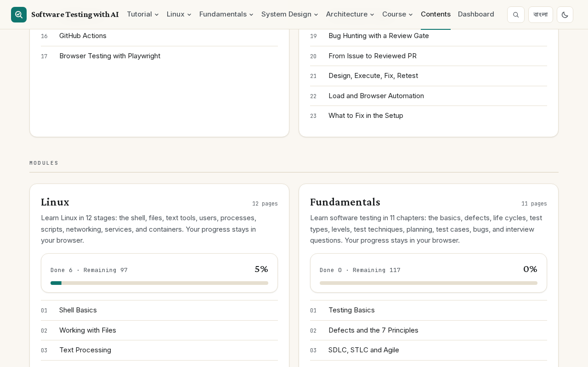

The home page has a hero with a stats row (tutorial parts, modules, pages, and text voices), three START HERE cards for new readers, a "Why this guide" block, and numbered course cards.

### Three voices for every section

109 pages let you read each `##` section in three voices:

| Voice | What it is |
|---|---|
| **Technical** | The full text, with the citations, the code, and the callouts |
| **সহজ English** | The same facts in plain English |
| **বাংলা** | The same facts in Bangla. Commands, flags, paths, product names, and acronyms stay in English. |

A switcher with four buttons sits under each section heading: `Technical`, `সহজ English`, `বাংলা`, and `সবগুলো` (all three at once). The Left, Right, Home, and End keys move the selection. A click changes one section only.

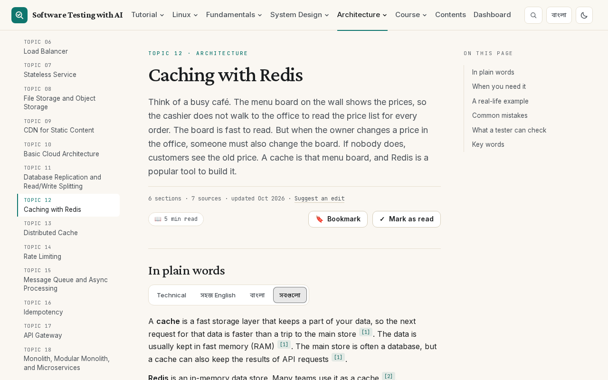

The `বাংলা` button in the header sets the default voice for the whole site. Click it and every section switches to Bangla, and the button changes to `English`. The site saves the choice in your browser and sets it before the first paint, so the page does not flash. In Bangla mode, the Bangla text moves to the first position of each switcher.

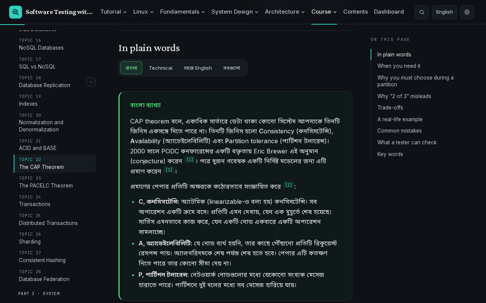

The Bangla text of the Course follows the term style of [systemdesignbangla.com](https://www.systemdesignbangla.com/): common concept words are in Bangla letters, and acronyms, products, and commands stay in English. The plain English and Bangla texts add no fact that the Technical text does not have. A separate agent checked this for each page.

A link or a search result that points into a hidden voice opens that voice and scrolls to the target.

### Fundamentals: two versions of each topic

The 11 Fundamentals chapters teach manual testing. Chapters 1–10 have two versions of every topic: **My notes** (the author's notes, with images) and **ISTQB** (the ISTQB syllabus and glossary, with citations and diagrams). A switch above the chapter changes the version. The site remembers your choice. If the notes and ISTQB disagree, the notes version has a warning that points you to the ISTQB definition. Chapter 11 is 50 interview questions.

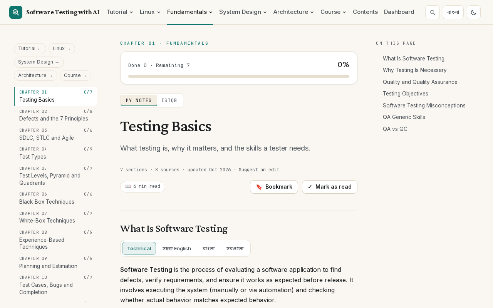

The ISTQB version has seven inline diagrams, for example the test pyramid, the test quadrants, and the bug life cycle. Each diagram has a text description under it.

### Progress, bookmarks, and the Dashboard

The site tracks your work in your browser. It never sends it to a server.

- **Topic checklists:** the Linux stages, the Fundamentals chapters, the Architecture topics (and its 30 practice questions), and the Course topics have checkboxes and progress bars.
- **Pages read and bookmarks:** each content page has a **Mark as read** toggle and a **Bookmark** toggle under its title.
- **Last page:** the site remembers the last content page that you opened.

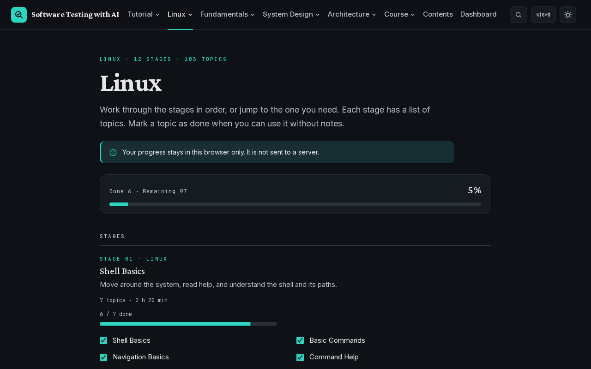

The [Dashboard](https://kawsar-95.github.io/ai-testing-guide/dashboard/) shows the pages you read (`N / 121`), your bookmarks, the topic progress of the four modules, and a Continue reading card. **Export** downloads your progress as `progress-YYYY-MM-DD.json`. **Reset** asks for confirmation, then clears all progress.

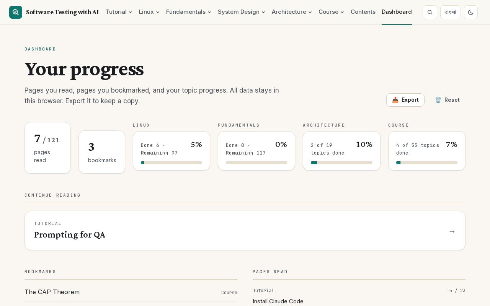

### Search

Press <kbd>Ctrl</kbd>/<kbd>Cmd</kbd>+<kbd>K</kbd>, or click the search button, to search all pages and all sections of every module. The search runs in your browser, so it also works offline. It finds prefixes and small typing mistakes, and it ranks titles first. The Up and Down keys move through the results, Enter opens one, and Escape closes the dialog. The plain English and Bangla texts are searchable too.

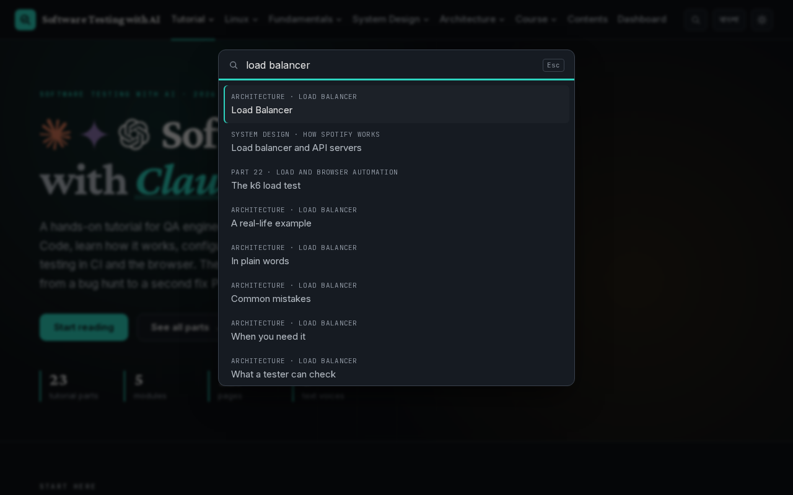

### Learning from real systems

- **System Design:** 15 case studies explain how one well-known system works. Each case has the same shape: the problem in plain words, a text diagram of the big picture, the mechanisms, a table of key words, and what a tester can learn.
- **Architecture:** 19 topics, each with a diagram, and a practice page with 30 questions. Each question has a checkbox and a model answer that you open when you are ready.
- **Course:** 40 topics from DNS to case studies, in 6 parts. Each topic has a real-life example, common mistakes, and what a tester can check. A topic of the Course that is covered by an Architecture or System Design page links to that page.

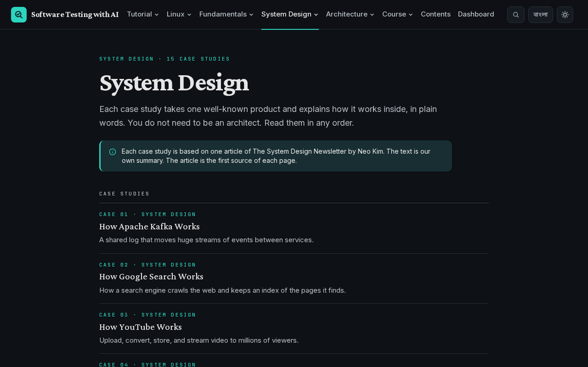

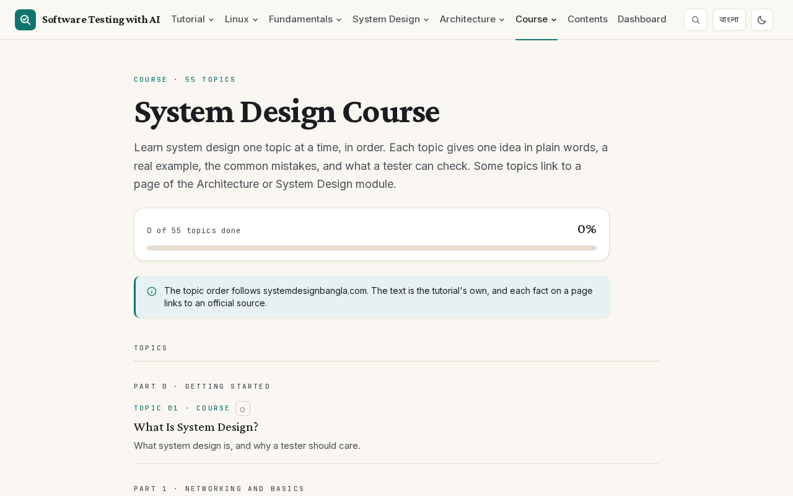

### Reading aids

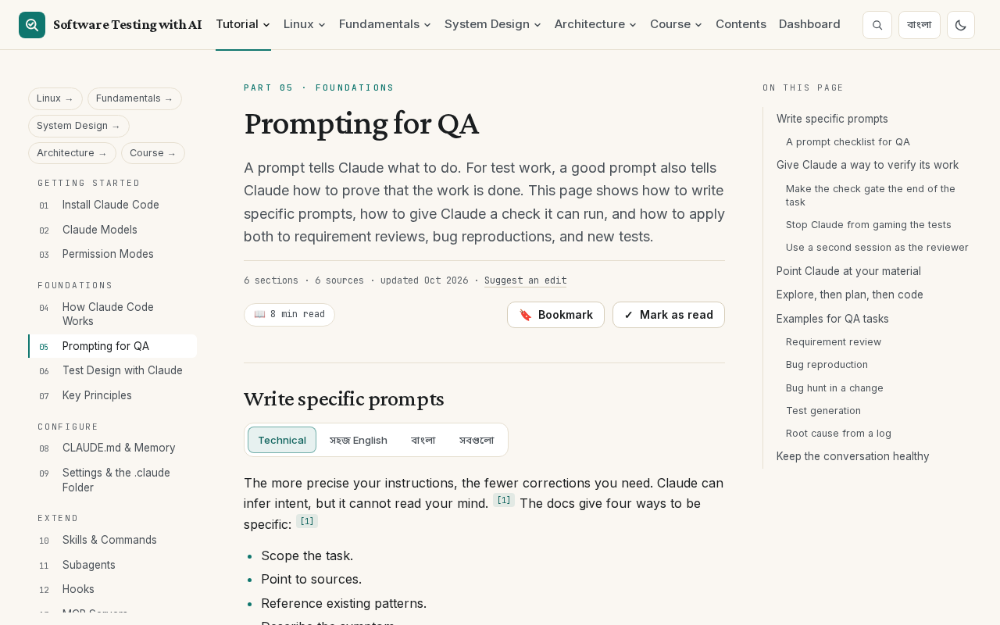

- **Three columns:** a left list of the pages of the current section, the text, and an "On this page" list of the sections. The current section stays marked as you scroll.
- **Reading time and progress:** each page shows `N min read`, and a bar under the header shows how far you read. A back-to-top button shows after one screen of scrolling.
- **Meta line:** the number of sections and sources, the update date, and a "Suggest an edit" link that opens the page source on GitHub.
- **Previous and next:** cards at the end of a page go to the neighbour pages.
- **Citations:** each fact has a `[n]` link to the numbered Sources list at the end of the page.
- **Code blocks:** syntax colors (Shiki), a language label, and a Copy button. Code blocks stay dark in both themes.
- **Callouts and cards:** note, tip, warning, and danger boxes, and Do and Don't cards.
- **Tables and images:** tables scroll sideways in their own box, and below 640 px each row becomes a card. Each image has a link to open it in full size.

### Light and dark themes

The site follows the theme of your system and remembers your choice. The theme button in the header switches it. The theme loads before the first paint, so the page does not flash the wrong theme. Every text color has a contrast ratio of 4.5:1 or more in both themes, and a test checks it.

### Phones and small screens

The layout adapts to phone widths. Below 1200 px the top navigation moves into a drawer, and the drawer has a link to each section. The drawer traps the focus, closes with Escape, and gives the focus back to the button that opened it. On phones, tables and code scroll inside their own box.

| A content page | The drawer |
|---|---|
| 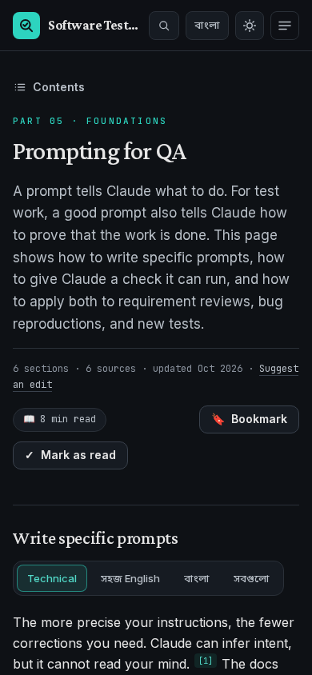 | 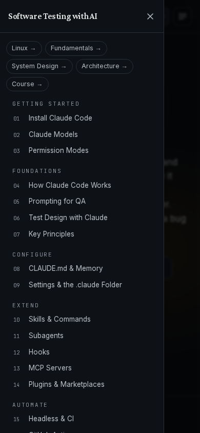 |

### Install it and read offline

The site is a progressive web app (PWA). Chromium browsers show an **Install** button in the header. After the first visit, the service worker has all 129 pages, the search index, and the images of the pages in its cache. Pages open from the cache first and update in the background. A page that is not in the cache shows the 404 page. Each new build replaces the old cache.

### Accessibility

The site has a skip link, visible focus rings, `aria-pressed` on every toggle, and labels that start with the visible word of the button. Motion is off if your system asks for reduced motion. The switchers, the drawer, the dropdowns, and the search dialog work with the keyboard only.

### Privacy

The site has no accounts and no server. Your progress, bookmarks, theme, voice, and version choice stay in the `localStorage` of your browser. Google Analytics is off unless the owner sets `NEXT_PUBLIC_GA_ID` at build time.

## How the content is made

Every page states facts that a reader can check.

- **Sources:** facts come from official docs first (`code.claude.com/docs`, `platform.claude.com/docs`, `modelcontextprotocol.io`, `playwright.dev`, and the GitHub repos of the tools), then from primary sources such as the ISTQB syllabi, IETF RFCs, and the Google SRE books. Blogs, forums, and AI summaries are not used. Two modules have a documented exception: the Linux roadmap links and the System Design newsletter articles are blogs, so those pages also cite an official source for each fact. [CLAUDE.md](CLAUDE.md) has the rules of each module.
- **Citations:** each fact has a numbered `[n]` link to the Sources list at the end of its page.
- **Fact-check:** an agent that did not write the page checked each claim against its cited source. Each page has a report in [`docs/superpowers/research/`](docs/superpowers/research/). A page is done only when its report ends with `Open FAILs: 0`.
- **Voices:** each page with voices has a second report. An agent that did not write the voices checked them against the Technical text.
- **Case study:** parts 18–23 describe the author's private practice workspace. Facts about that workspace have no citation link. A separate agent checked each one against the workspace files. Emails, phone numbers, and similar values are replaced with placeholders.
- **Dates:** each page shows the date of its last update. "Suggest an edit" opens the page source on GitHub.

Claude Code changes often. If a page is out of date, open an issue or a pull request.

## Run it locally

You need Node.js 22.18 or newer. The check scripts also need Python 3.

```bash
git clone https://github.com/kawsar-95/ai-testing-guide.git
cd ai-testing-guide
npm install
npm run dev
```

Open http://localhost:3000.

To build and preview the static site:

```bash
npm run build                          # writes the static site to out/
python3 -m http.server 8000 -d out     # serves it at http://localhost:8000
```

`next start` does not work with a static export. Use the preview command above.

## Scripts and checks

| Command | What it does |
|---|---|
| `npm run dev` | Starts the dev server. The offline app (service worker) works only in a production build. |
| `npm run build` | Builds the static site into `out/`. |
| `npm test` | Runs the unit tests in `tests/` with `node --test`. |
| `python3 -m unittest scripts/test_checks.py` | Runs the unit tests of the Python check scripts. |
| `python3 -m unittest scripts/test_linux_scripts.py` | Runs the unit tests of the Linux research scripts. |
| `python3 scripts/check_routes.py out` | Checks that every route of the route maps has a built page. |
| `python3 scripts/check_links.py out` | Checks internal links and assets. |
| `python3 scripts/check_outline.py out` | Checks that every "On this page" link has a target. |
| `python3 scripts/check_sources.py out` | Checks the meta line, the citations, and the Sources list of each content page. It must print `OK 121 pages checked, 0 skipped`. |

Run the `out` checks after `npm run build`, on a build without a base path.

## Project structure

```text
app/                 Routes, root layout, global styles, sitemap, robots, search index, PWA files
components/          Site shell, navigation, page parts, MDX components, voices, progress, module pages
content/<group>/     The MDX pages: 23 tutorial, 12 Linux, 11 Fundamentals, 15 System Design, 20 Architecture, 40 Course
lib/                 nav.ts (tutorial page order), one data file for each module, search, voices, PWA, and other helpers
tests/               Unit tests (node --test)
scripts/             Python check scripts and the route maps (one JSON file for each module)
public/              Icons, images of the pages, and static files
docs/                Architecture, screenshots (docs/assets), design specs, plans, the content audit, research notes
```

For how the parts fit together, read [docs/ARCHITECTURE.md](docs/ARCHITECTURE.md).

## Add or change a page

For a tutorial page:

1. Create or edit `content/<group>/<slug>.mdx`. Use the page template in [CLAUDE.md](CLAUDE.md#page-template).
2. For a new page, add it to `lib/nav.ts` and to `scripts/route-map.json`.
3. Give each fact a `<Cite n={k} />` and a matching entry in `page.sources`.
4. Run `npm test`, `npm run build`, and the checks above.

The other modules keep their page lists in their own data files: `lib/linux/stages.ts`, `lib/fundamentals/chapters.ts`, `lib/system-design/cases.ts`, `lib/architecture/topics.ts`, and `lib/course/topics.ts`. Each module has its own route map in `scripts/`. A page with voices also needs a voice fact-check report. `npm test` checks that the lists, the MDX files, and the route maps agree.

[CLAUDE.md](CLAUDE.md) has the full rules: the MDX components, the voices, the citation rules, and the research and fact-check workflow. It is written as the guide for AI coding agents, and it is the most complete reference for humans too.

## Deploy

Each push to `main` deploys the site to GitHub Pages through [`.github/workflows/deploy-pages.yml`](.github/workflows/deploy-pages.yml). The workflow runs `npm ci`, `npm test`, and `npm run build`, then publishes `out/`.

The site lives under `/ai-testing-guide/`. The workflow sets `PAGES_BASE_PATH` for that path and `NEXT_PUBLIC_SITE_URL` for canonical URLs and the sitemap. Local builds serve from `/`. See [docs/ARCHITECTURE.md](docs/ARCHITECTURE.md#base-path-github-pages) for the rules that keep links correct under the base path.

`NEXT_PUBLIC_GA_ID` is optional. If you set it, the build adds Google Analytics.

## Tech stack

| Part | Choice |
|---|---|
| Framework | Next.js 16 (App Router, static export), React 19, TypeScript |
| Content | MDX with `@next/mdx`, `remark-gfm`, `rehype-slug`, and Shiki (`@shikijs/rehype`) |
| Styles | Tailwind CSS 4 and CSS design tokens |
| Fonts | Crimson Pro, Inter, JetBrains Mono, and Noto Sans Bengali (`next/font/google`) |
| Search | MiniSearch, with a static search index |
| Offline | A service worker and a web manifest, built from `lib/pwa.ts` |
| Hosting | GitHub Pages, deployed by GitHub Actions |

## Documentation

| Document | What it has |
|---|---|
| [CLAUDE.md](CLAUDE.md) | The rules for each module, the voices, the MDX components, and the content workflow. The most complete reference. |
| [docs/ARCHITECTURE.md](docs/ARCHITECTURE.md) | How the site is built: routes, ordered lists, MDX pipeline, voices, progress, search, theme, PWA, base path, deploy, and checks |
| [docs/superpowers/specs/](docs/superpowers/specs/) and [docs/superpowers/plans/](docs/superpowers/plans/) | The design and the plan of each phase and module |
| [docs/superpowers/research/](docs/superpowers/research/) | The research notes and the fact-check reports of each page |
| [docs/superpowers/audits/](docs/superpowers/audits/) | The audit of the outdated claims of the first tutorial text |
| [docs/assets/](docs/assets/) | The screenshots of this README |

## Credits

- Tutorial and code by [kawsar-95](https://github.com/kawsar-95).
- The look follows [systemdesignbangla.com](https://www.systemdesignbangla.com/) (a style reference only; no CSS, text, or art is copied). The earlier editorial shell came from [All Necessary Topics Related to AI Engineering](https://github.com/kawsar-95/All-Necessary-Topics-Related-to-AI-Engineering).
- The Course follows the topic order of systemdesignbangla.com. The text is the tutorial's own.
- The System Design case studies are based on articles of The System Design Newsletter (systemdesign.one) by Neo Kim.
- This is an independent tutorial. Anthropic does not maintain or endorse it.

## License

[MIT](LICENSE)
