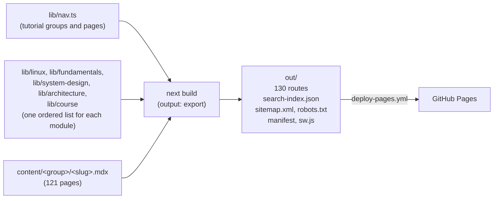

# Architecture

This document explains how the site is built and how its parts work together. It is for developers who change the code or add content. For the step-by-step rules (page templates, MDX components, voices, citation rules), read [CLAUDE.md](../CLAUDE.md). For what a reader can do on the site, read the Features section of the [README](../README.md#features).

## Overview

The site is a static export of a Next.js 16 App Router project. There is no server and no database. The build reads the data files in `lib/` and the MDX files in `content/`, renders every page to HTML, and writes the result to `out/`. GitHub Pages serves `out/`. The progress of a reader lives in the `localStorage` of the browser of that reader.



The ordered lists and the MDX files are the inputs. Everything else is code that turns them into pages. `npm test` checks that each list and its MDX files agree.

## Routes

The site has 130 routes.

| Route | Source | Output |
|---|---|---|
| `/` | `app/(site)/page.tsx` → `components/pages/HomePage.tsx` | The home page: the hero with the stats row, START HERE, "Why this guide", and the numbered course cards |
| `/contents/` | `app/(site)/contents/page.tsx` → `ContentsPage` | All groups and modules as cards, with progress bars |
| `/dashboard/` | `app/(site)/dashboard/page.tsx` → `DashboardPage` | The progress of the reader, and the author block |
| `/interview/` | `app/(site)/interview/page.tsx` → `InterviewPage` | Three cards that link to the interview material. It has no MDX file. |
| `/<group>/<slug>/` | `app/(site)/[group]/[page]/page.tsx` | The 23 tutorial pages |
| `/linux/`, `/linux/<stage>/` | `app/(site)/linux/` | The roadmap and the 12 stages (13 routes) |
| `/fundamentals/`, `/fundamentals/<chapter>/` | `app/(site)/fundamentals/` | The home and the 11 chapters (12 routes) |
| `/system-design/`, `/system-design/<slug>/` | `app/(site)/system-design/` | The home and the 15 case studies (16 routes) |
| `/architecture/`, `/architecture/<slug>/` | `app/(site)/architecture/` | The home, the 19 topics, and the practice page (21 routes) |
| `/course/`, `/course/<slug>/` | `app/(site)/course/` | The home and the 40 topics (41 routes) |
| `/search-index.json` | `app/search-index.json/route.ts` | The search documents (static) |
| `/sitemap.xml`, `/robots.txt` | `app/sitemap.ts`, `app/robots.ts` | SEO files |
| `/manifest.webmanifest`, `/sw.js` | `app/manifest.ts`, `app/sw.js/route.ts` | The installable app and its service worker |
| 404 | `app/not-found.tsx` | The 404 page |

`app/layout.tsx` is the root layout. It sets the fonts, the head scripts (theme, voice, Fundamentals version, install prompt), the metadata, and optional Google Analytics. `app/(site)/layout.tsx` wraps every page in `SiteShell` (header, footer, drawer) and adds the search dialog.

All route handlers use `export const dynamic = "force-static"`, so the build writes their output as files.

## Navigation: ordered lists

Each part of the site has one ordered list. The lists drive the drawer, the home pages, prev/next, search, the sitemap, the precache list, and the static params.

| Part | List | Notes |
|---|---|---|
| Tutorial | `lib/nav.ts` | Groups and pages (`slug`, `title`, `description`, `tagline`). It derives `part` (1–23, continuous across the groups), `href`, `PAGES`, `GROUPS`, and `getNeighbors`. |
| Linux | `lib/linux/stages.ts` | 12 stages and 103 topics. A topic has an `id`, a title, and an `anchor`. |
| Fundamentals | `lib/fundamentals/chapters.ts` | 11 chapters and 117 topics. A topic id is `<chapter-slug>-NNN`. |
| System Design | `lib/system-design/cases.ts` | 15 case studies. A flat module. |
| Architecture | `lib/architecture/topics.ts` | 19 topics and a practice page with 30 questions. A flat module. |
| Course | `lib/course/topics.ts` | 55 entries in 6 parts: 40 topics with a page and 15 links to Architecture and System Design pages. A flat module. |

The top nav comes from `lib/header-nav.ts` (`HEADER_NAV`). It has four plain links: Home, Contents, Dashboard, and Interview. `activeNavId` marks the current item, and a tutorial or module page has none. A reader reaches a module from the home page or the contents page. `lib/interview.ts` holds the strings and the three cards of the interview page.

### Flat modules

System Design, Architecture, and Course have the same shape: a home page and a list of pages at `/<id>/<slug>/`. `defineFlatModule` (`lib/modules/flat.ts`) builds the routes, the numbers, the neighbours, and the progress ids from one entry list. An entry is a `topic` (a page), a `practice` (a page with its own question ids), or a `link` (a link to another page, with no page of its own).

`lib/modules/registry.ts` holds `FLAT_MODULES` and `PROGRESS_MODULES`. The PWA, the sitemap, the stats, the search, the contents page, and the dashboard read the modules from it. Two thin route files show a flat module: `app/(site)/<id>/page.tsx` renders `FlatModuleHome`, and `app/(site)/<id>/[topic]/page.tsx` renders `FlatTopicPage`. The shared components live in `components/modules/`. CLAUDE.md has the five steps that add a module.

## Content pages

### The MDX file

Each page exports two objects and then starts with its title:

```mdx
export const metadata = { title: '…', description: '…' }
export const page = { updated: 'YYYY-MM-DD', sources: [ { title, publisher, url, accessed } ] }

# Title

Lede paragraph.

<PageMeta />

## First section
```

- `metadata` is the standard Next.js metadata object. The page route returns it from `generateMetadata`.
- `page` (type `PageInfo` in `lib/page.ts`) holds the update date and the numbered sources.
- `<PageMeta />` is a placeholder. The page route fills it in with the meta line and the reading tools.

### The MDX pipeline

`next.config.ts` sets `output: 'export'`, `trailingSlash: true`, and `images.unoptimized`. It wraps the config with `@next/mdx` and these plugins:

| Plugin | Job |
|---|---|
| `remark-gfm` | GitHub-flavored Markdown: tables, task lists, strikethrough |
| `rehype-slug` | Gives every heading an `id` |
| `@shikijs/rehype` | Syntax colors at build time (theme `github-dark-dimmed`) |

The plugins are given by name (strings), because Turbopack passes their options to Rust and they must be serializable.

`mdx-components.tsx` maps MDX elements and components:

| MDX | Rendered by |
|---|---|
| `Callout`, `CardGrid`, `InfoCard`, `Cite` | `components/mdx/` |
| `pre` (fenced code) | `CodeBlock`: language label and Copy button |
| `table` | `MdxTable`: a box that scrolls sideways, and cards on phones |
| `img`, `MdxImage` | An image with the base path and a link to the full size |
| `a` with an `href` that starts with `/` | `next/link` (adds the base path) |
| `Voices`, `Technical`, `Layman`, `Bangla` | `components/voice/` |
| `Version`, the Fundamentals diagrams | `components/fundamentals/` |
| `PracticeQuestion` | `components/architecture/` |

### The page route

`app/(site)/[group]/[page]/page.tsx` does this for each tutorial page:

1. Gets the page from `lib/nav.ts`. Unknown params give a 404 (`dynamicParams = false`).
2. Imports `content/<group>/<page>.mdx` with a dynamic import.
3. Reads the outline with `getOutline(group, slug)`.
4. Renders `ChapterLayout` with `ReadingProgress`, `PageHeader` (the eyebrow, for example `PART 08 · CONFIGURE`), the article, `Sources`, `PrevNext`, `SectionNav`, and `BackToTop`.

The module pages use the same layout: `FlatTopicPage` for the flat modules, and the stage and chapter routes of Linux and Fundamentals.

### Headings, outline, and anchors

The "On this page" list and the search results link to heading ids. Those ids must match the ids that `rehype-slug` writes into the HTML.

`lib/headings.ts` reads the MDX source, skips fenced code, and slugs every heading (levels 1–6, in document order) with one `github-slugger` instance per page. This is the same algorithm as `rehype-slug`, so a repeated heading gets the same `-1` suffix in both. `lib/outline.ts` returns the level 2 and 3 headings from it, and `lib/search.ts` uses it for section links. `scripts/check_outline.py` checks the built HTML: every "On this page" link must have a matching id.

## Page layout and navigation parts

`ChapterLayout` (`components/content/`) has three columns for the 121 content pages.

| Column | Shows | From |
|---|---|---|
| Left, 240 px, sticky | `ChapterList`: the pages of the current module | The `chapter` breakpoint (51.25 rem, 820 px) |
| Middle, 720 px at most | The article | Always |
| Right, 280 px | `SectionNav` ("On this page") | The `toc` breakpoint (80 rem, 1280 px) |

The whole layout is 1400 px wide at most. The page passes its route to `ChapterLayout`, so the static HTML already has the right list.

| Component | Job |
|---|---|
| `SiteShell` | Skip link, header, main area, footer |
| `SiteHeader`, `HeaderNav` | The sticky 64 px header: the brand mark, the top nav of four links (from the `nav` breakpoint, 75 rem), search, voice toggle, install button, theme toggle, and the menu button (below `nav`) |
| `MobileNav`, `ContentsButton` | The drawer: the four nav links (below `nav` only) above the list of the current module, focus trap, Escape to close, page scroll lock, and the focus returns to the opening button. Below `chapter`, `ContentsButton` on a content page opens it through the `OPEN_NAV_EVENT` window event. |
| `NavList`, `SidebarList`, and the module lists | The lists of the drawer and the left column |
| `SearchPalette` | The search dialog (see Search) |
| `RegisterServiceWorker` | Registers `/sw.js` in production builds |

`lib/scroll-lock.ts` is one shared lock for page scrolling. The drawer and the search dialog both use it, so closing them in any order unlocks the page correctly.

## Voices

A `##` section can have three voices of its text: Technical, plain English (`Layman`), and Bangla. 109 pages have voices. The Fundamentals chapters, `architecture/practice`, every `## Key words` section, and the Linux "Permissions Cheat Sheet" topic have none.

| Part | Where | Job |
|---|---|---|
| Head script | `VOICE_INIT_SCRIPT` in `lib/voice.ts` | Runs after the theme script and sets `data-voice-default` on `<html>` before the first paint. Only the stored value `bangla` gives Bangla. |
| Store | `components/voice/useVoiceDefault.ts` | A `useSyncExternalStore` hook on `data-voice-default`. `setVoiceDefault` saves `voice` to `localStorage`. A `storage` event of another tab updates it. |
| Section | `Voices.tsx`, `VoiceSwitcher.tsx`, `panels.tsx` | `Voices` holds the state of one section. The switcher has 4 buttons (Technical, `সহজ English`, `বাংলা`, `সবগুলো`) with arrow-key navigation. Panels render `<div data-panel="…">`. |
| Header | `components/layout/VoiceToggle.tsx` | Sets the site-wide default voice. Every section follows it. |
| CSS | `app/globals.css` | Before hydration, the panel of `html[data-voice-default]` shows. After hydration, the `data-voice` of the wrapper decides. |
| Reveal | `Voices.tsx` | A URL hash, or a click on an in-page link, that targets an element in a hidden panel shows that panel and scrolls to the element. |

`lib/voice-source.ts` is the authoring check for `<Voices>` blocks. `tests/voice-source.test.ts` runs it on every MDX file. Each page with voices has a voice fact-check report in `docs/superpowers/research/`. The authoring rules are in CLAUDE.md.

## Progress, reading state, and Dashboard

All progress is client-side. The shared code keeps its old `prep` names (`lib/prep/progress.ts`, `lib/prep/store.ts`, `components/prep/`). It is left from a module that was removed on 2026-10-20 (it is in the git history). A store keeps its value in memory and mirrors it to `localStorage`. If storage is blocked or full, the value stays in memory for the session and nothing throws.

| `localStorage` key | Holds |
|---|---|
| `linux-progress`, `fundamentals-progress`, `architecture-progress`, `course-progress` | Lists of done topic ids |
| `page-read`, `page-bookmarks` | Lists of routes |
| `last-page` | One route: the last content page that the reader opened |
| `theme`, `voice`, `fundamentals-version` | The theme, the default voice, and the Fundamentals version |

`ChapterTools` (the reading pill, Bookmark, and Mark as read) sits under the meta line of each content page. Reading time comes from `lib/reading-time.ts`: the words of the technical text, without code, export statements, tags, or link URLs. A Fundamentals chapter has one value for each version, and the CSS shows the one of the switch.

The Dashboard (`components/pages/DashboardPage.tsx`) shows the pages read (`N / 121`), the bookmarks, the topic progress of the four modules, and a Continue reading card. It ends with an "About the author" block: the `AUTHOR` object in `lib/site.ts` and a photo in `public/images/author/`. Export downloads `progress-YYYY-MM-DD.json` with the keys of `PROGRESS_KEYS` (`lib/reading-state.ts`). Reset asks first, then clears those keys. The helpers are in `lib/dashboard-data.ts`, so `lib/sitemap.ts` has no import cycle.

## Fundamentals version switch

Chapters 1–10 of Fundamentals have two versions of each topic: the owner's notes and an ISTQB version. Both are in the HTML, so search and `check_sources.py` see both.

1. Each topic has a `<Version of="notes">` and a `<Version of="istqb">` block. `Version` renders `<div data-version="…">`.
2. `VERSION_INIT_SCRIPT` (`lib/fundamentals/version.ts`) runs in `<head>` and sets `<html data-fundamentals-version>`. A saved choice wins. Any other value gives `istqb`.
3. `VersionSwitch` shows two buttons above the chapter. A click sets the attribute, saves the choice in `try/catch`, and fires `fundamentals-version-change`.
4. `app/globals.css` hides the block that is not the one on `<html>`.

`lib/fundamentals/structure.ts` and `tests/fundamentals-structure.test.ts` check that each topic has one block of each version and that no heading is inside a block. The ISTQB diagrams are inline SVG components in `components/fundamentals/diagrams/`. Each one is in a `Figure` with a visible description, and its colors come from the theme tokens.

## Search

| Step | Where | What happens |
|---|---|---|
| Build | `app/search-index.json/route.ts` | Reads every MDX file and calls `buildSearchDocs` (`lib/search.ts`). One document per page intro and one per `##` section. The text has the Markdown and JSX syntax removed. Code text is kept. The Layman and Bangla texts go into the document of their section. The flat modules are added with `flatDocs`. |
| First open | `components/navigation/SearchPalette.tsx` | <kbd>Ctrl</kbd>/<kbd>Cmd</kbd>+<kbd>K</kbd> or the header button opens the dialog. On the first open it fetches `search-index.json` and builds a MiniSearch index in the browser. |
| Query | `lib/search.ts` (`runSearch`) | Prefix and fuzzy search. Titles count 3×, page names 1.5×. Up to 8 results. |

`lib/search.ts` must not import `node:fs` or `lib/outline.ts`, because the browser bundle imports it. It uses `lib/headings.ts`, which has no Node dependency. `SearchPalette` prefixes the base path to its `fetch`.

## Theme and design

- Two themes: dark (the server default) and light (warm paper). The design tokens are CSS variables in `app/globals.css`, one set for each theme on `<html data-theme>`. `@theme inline` maps them to Tailwind colors such as `bg-bg-raised` and `text-accent`. The accent is teal and `--accent-2` is amber. The tokens `--voice-layman` and `--voice-bangla` color the extra voice panels.
- An inline script (`THEME_INIT_SCRIPT` in `lib/theme.ts`) runs in `<head>` before the first paint. A saved choice (`localStorage` key `theme`) wins. Without one, the script follows `prefers-color-scheme`. A reader never sees the wrong theme first. `tests/theme.test.ts` runs the script in a VM and checks that it gives the same result as `resolveTheme`.
- `ThemeToggle` switches the theme and saves the choice.
- Every text color has a contrast of 4.5:1 or more on the three background tokens in both themes. `tests/contrast.test.ts` reads `app/globals.css` and checks this.
- Fonts load with `next/font/google`: Crimson Pro (display), Inter (body), JetBrains Mono (labels and code), and Noto Sans Bengali (`preload: false`, so the browser loads it only when Bengali text first shows).

The look follows the reference site [systemdesignbangla.com](https://www.systemdesignbangla.com/). It is a style reference only: no CSS, text, or art is copied. The earlier editorial shell came from the owner's [All Necessary Topics Related to AI Engineering](https://github.com/kawsar-95/All-Necessary-Topics-Related-to-AI-Engineering) site.

## Installable app (PWA)

`lib/pwa.ts` builds the web manifest, the precache list, and the service worker source.

| Part | Behavior |
|---|---|
| Install | Caches all 130 routes, the 404 page, the search index, the manifest, and the icons, plus the build files and the `/images/` files that the pages use |
| Pages, RSC payloads, and the search index | Stale-while-revalidate. The cache answers first, and the worker updates the cache from the network in the background. The cache key has no query string. |
| `/_next/static/` files | Cache first. Their file names have a content hash. |
| Offline, page not cached | Shows the cached 404 page |
| New build | `/sw.js` gets a new cache version. The new worker caches all pages again and deletes older caches. |
| Install button | `INSTALL_CAPTURE_SCRIPT` (`lib/pwa-install.ts`) keeps an early `beforeinstallprompt` event. `InstallButton` shows only after that event (Chromium). |

Only production builds register the service worker. `npm run dev` has none, so dev pages never come from an old cache. A new page in any ordered list goes into the precache list by itself.

## SEO and environment variables

`lib/site.ts` reads two optional variables. A build without them passes.

| Variable | Effect |
|---|---|
| `NEXT_PUBLIC_SITE_URL` | Sets `metadataBase`, canonical URLs, Open Graph data, the `sitemap.xml` entries, and the sitemap line in `robots.txt`. |
| `NEXT_PUBLIC_GA_ID` | Adds Google Analytics (`@next/third-parties`). |

`lib/sitemap.ts` (`sitemapPaths()`) lists the paths of the sitemap. It has relative `.ts` imports, so `node --test` can load it. The 404 page has no canonical URL and no Open Graph data.

## Base path (GitHub Pages)

GitHub Pages serves the site at `/ai-testing-guide/`. The deploy workflow sets `PAGES_BASE_PATH` to that path. `next.config.ts` uses it as `basePath` and exposes it to the browser as `NEXT_PUBLIC_BASE_PATH` (`BASE_PATH` in `lib/site.ts`). Local builds leave it empty and serve from `/`.

| Adds the base path by itself | Needs the base path added by hand |
|---|---|
| `next/link`, `router.push`, metadata URLs | `fetch()`, plain `<a href>`, plain ``, service worker URLs, manifest URLs |

So:

- `SearchPalette` prefixes the base path to its `fetch`.
- `mdx-components.tsx` renders MDX links that start with `/` through `next/link`.
- `MdxImage` adds the base path to the `src` of an image with `withBasePath` (`lib/base-path.ts`).
- `lib/pwa.ts` and `RegisterServiceWorker` build every URL from the base path.
- In content, write internal links as `/group/page/`. Never include the repository name.

## Deploy

`.github/workflows/deploy-pages.yml` runs on every push to `main` and on manual dispatch:

1. `actions/configure-pages` gives the base path and the site URL.
2. `npm ci` and `npm test`.
3. `npm run build` with `PAGES_BASE_PATH` and `NEXT_PUBLIC_SITE_URL`.
4. Upload `out/` and deploy it with `actions/deploy-pages`.

The Python checks are not part of the workflow, because they expect a build without a base path. Run them locally before you push.

## Tests and checks

| Check | Type | What it protects |
|---|---|---|
| `npm test` | Node unit tests (`tests/*.test.ts`, run without a compile step on Node 22.18 or newer) | The nav lists and the files in `content/`, outline ids, search docs and ranking, theme and voice head scripts, page helpers, reading aids and reading state, the Dashboard, the PWA manifest, precache list, and worker, the data of each module, the Fundamentals version logic and structure, the `<Voices>` authoring rules, the header nav, and the token contrast |
| `python3 -m unittest scripts/test_checks.py` | Python unit tests | The check scripts themselves |
| `python3 -m unittest scripts/test_linux_scripts.py` | Python unit tests | The Linux research scripts |
| `check_routes.py out` | Build check | Every route of the route maps has a page |
| `check_links.py out` | Build check | No broken internal links or assets |
| `check_outline.py out` | Build check | Every "On this page" link has a target id |
| `check_sources.py out` | Build check | Each content page has one meta line, at least one source, a source for every `[n]` cite, a cite for every source, and `https://` source links. It prints `OK 121 pages checked, 0 skipped`. |

The route maps in `scripts/` list the routes that the build checks read: `route-map.json` (tutorial) and one file each for Linux, System Design, Fundamentals, Architecture, Course, contents, dashboard, and interview. `npm test` checks that each page is in its map.

`scripts/compare_text.py` is a record of an earlier migration. It cannot run now. `scripts/linux_fetch.py` and `scripts/linux_overlap.py` are research tools for the Linux and System Design modules. The raw text that they download is third-party text and is never committed.

## Content workflow

The text follows a source-first process. The details are in [CLAUDE.md](../CLAUDE.md#content-workflow).

1. **Research:** collect sources and quotes in `docs/superpowers/research/<group>-<slug>.md`.
2. **Write:** change the MDX. Each fact gets a `<Cite n>` and a `page.sources` entry.
3. **Fact-check:** a separate reviewer checks each claim against its source and writes `docs/superpowers/research/<group>-<slug>.factcheck.md`. The page is done when the report ends with `Open FAILs: 0`.
4. **Voices:** a page with voices also gets `<group>-<slug>.voices.factcheck.md`, written by an agent that did not write the voices.
5. **Verify:** `npm run build` and `python3 scripts/check_sources.py out`.

## Project history

The design documents in `docs/superpowers/` record how the site got here. The specs say what and why, and the plans say how. The research notes and fact-check reports are in `docs/superpowers/research/`.

| Phase | Spec | Plan |
|---|---|---|
| Move to grouped URLs (Nextra, later replaced) | [spec](superpowers/specs/2026-10-09-nextra-reorganization-design.md) | [plan](superpowers/plans/2026-10-09-nextra-reorganization.md) |
| Editorial redesign (custom shell) | [spec](superpowers/specs/2026-10-09-editorial-redesign-design.md) | [plan](superpowers/plans/2026-10-09-editorial-redesign.md) |
| Content refresh (17 cited pages) | [spec](superpowers/specs/2026-10-10-content-refresh-design.md) | [plan](superpowers/plans/2026-10-10-content-refresh.md) |
| Case Study group (parts 18–23) | [spec](superpowers/specs/2026-10-10-case-study-design.md) | [plan](superpowers/plans/2026-10-10-case-study.md) |
| Interview Prep module (removed on 2026-10-20; the current `/interview/` page is a small new page, not this module) | [spec](superpowers/specs/2026-10-13-prep-module-design.md) | [plan](superpowers/plans/2026-10-13-prep-module.md) |
| Linux module | [spec](superpowers/specs/2026-10-16-linux-module-design.md) | [plan](superpowers/plans/2026-10-16-linux-module.md) |
| Fundamentals module | [spec](superpowers/specs/2026-10-20-fundamentals-module-design.md) | [plan](superpowers/plans/2026-10-20-fundamentals-module.md) |
| Architecture module | [spec](superpowers/specs/2026-10-20-architecture-module-design.md) | none |
| Voices (Technical, plain English, Bangla) | [spec](superpowers/specs/2026-10-20-voices-design.md) | [plan](superpowers/plans/2026-10-20-voices.md) |
| Chapter page and Dashboard | [spec](superpowers/specs/2026-10-21-chapter-page-dashboard-design.md) | [plan](superpowers/plans/2026-10-21-chapter-page-dashboard.md) |
| Reference redesign (current look) | [spec](superpowers/specs/2026-10-21-reference-redesign-design.md) | [plan](superpowers/plans/2026-10-21-reference-redesign.md) |
| Flat modules | [spec](superpowers/specs/2026-10-22-flat-modules-design.md) | [plan](superpowers/plans/2026-10-22-flat-modules.md) |
| System Design Course | [spec](superpowers/specs/2026-10-22-course-module-design.md) | Deliveries [1](superpowers/plans/2026-10-22-course-delivery-1.md), [2](superpowers/plans/2026-10-22-course-delivery-2.md), [3](superpowers/plans/2026-10-22-course-delivery-3.md), [4](superpowers/plans/2026-10-22-course-delivery-4.md), [5](superpowers/plans/2026-10-22-course-delivery-5.md) |

An earlier redesign ([spec](superpowers/specs/2026-04-18-w3schools-redesign.md), [plan](superpowers/plans/2026-04-18-w3schools-redesign.md)) is replaced by the editorial redesign. The [content audit](superpowers/audits/2026-10-09-content-audit.md) lists the outdated claims of the old tutorial and, in its resolution section, the page that fixes each one.
